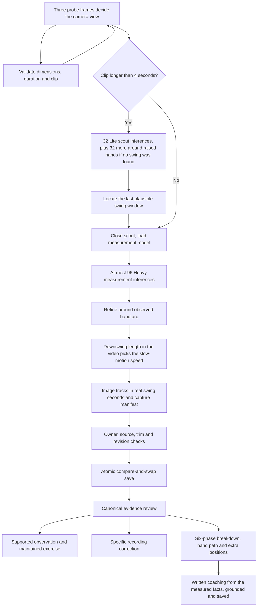
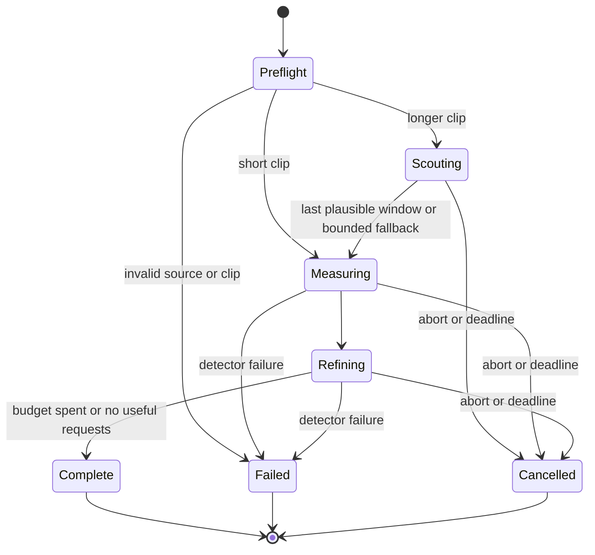

# Swing analysis architecture

The design objective is **bounded local processing with conservative, traceable coaching**. A single phone camera cannot provide foolproof biomechanical measurements. The system must return a useful supported observation, ask for a specific correction, or abstain. It must not turn an unavailable reading into a good score, or a detector's visibility probability into measurement accuracy.

This document describes the implemented architecture and the remaining empirical validation requirement. There is no claim of validated real-world accuracy.

## End-to-end data path



Scouting coordinates never enter measurement tracks. The scout locates a time interval; the Heavy model independently re-reads it. All scored positions come from one pinned measurement model. The architecture retains Heavy until a lighter measurement model demonstrates acceptable holdout error; a smaller network is not assumed equally accurate.

## Modules and contracts

| Module | Responsibility | Boundary |
| --- | --- | --- |
| `lib/swing/policy.ts` | Engine version and immutable resource budgets | No model, validation or UI dependency |
| `lib/swing/contracts.ts` | Strict capture-manifest schema | Diagnostics are client-reported, not an accuracy certificate |
| `lib/swing/manifest.ts` | Shared pure manifest validator | Keeps the schema library out of the video player |
| `lib/swing/capture.ts` | Sequential capture orchestration with injected source and algorithms | No React, database or browser globals required |
| `lib/pose-runner.ts` | Browser seeking, capture ownership, identity selection, sampling | A newer run cancels the previous owner of that video element |
| `lib/pose-worker-client.ts` | One pending inference; bounded bitmap; worker and foreground fallback | Rejects overlapping calls; releases worker, canvas and bitmaps |
| `lib/pose-detector.ts` | Pinned Lite/Heavy model assets; GPU-to-CPU fallback | Random-access decoding uses IMAGE mode |
| `lib/swing/segments.ts` | Detect separate plausible swing arcs | The last candidate is measured; candidates do not prove timing |
| `lib/golf/motion-analysis.ts` | Projected geometry, phase estimates, sampling ranges and slow-motion speed | No inferred depth used for player-facing measurements |
| `lib/golf/framing.ts` | Recording framing aid and face-on/down-the-line detection | A shoulder-geometry heuristic, not a calibrated classifier |
| `lib/swing/review.ts` | Canonical evidence and coaching decision | Shared by browser, detail page and coaching endpoint |
| `lib/db/repo.ts` | Ownership and atomic revision/source/trim checks | Stale writes fail explicitly, including concurrent tabs |
| `lib/golf/swing-breakdown.ts` | GolfPosePro-style six phases, hand-height trace, knee, hand-height and finish positions | Derived from the same tracks and phases; no new detector |
| `lib/ai/swing-feedback.ts` | Detailed written coaching from measured facts, with a rule-based report of the same shape | Every quoted figure must appear in the facts; output is validated, trimmed and saved per tracks/club/model |
| `lib/swing/evaluation.ts` | Offline recorded-corpus evaluation and release eligibility | Synthetic fixtures never count as real-world validation |

The manifest records engine/model identity, timestamp source, input dimensions, preprocessing bound, inference/seek/duplicate/rejected-pose counts and elapsed time. It persists with the image tracks through compact storage. Changing the engine invalidates coaching cache fingerprints. Old image recordings remain reviewable; absent decoded-timestamp provenance withholds rhythm.

Slow-motion integration keeps stored sample times in real swing seconds and stores the playback slowdown alongside them. Video time equals sample time multiplied by that slowdown. Nobody enters the slowdown: capture runs in video seconds, then the downswing's length in the video picks the nearest of real speed, 4× or 8× (a 0.32 s downswing is assumed; the pick tolerates at least about 40% either way). Hand-arc detection ignores sample gaps, so it works before the time base is known. A misread speed scales absolute durations and the gap tolerances but not the rhythm ratio. The camera view is detected the same way, from shoulder spacing relative to torso length on three early probe frames. Seeking and replay use video time. Upload validation checks both time bases consistently. Reference metadata uses the same revision guards, and reference comparisons pass through the canonical evidence gate.

## Capture state and resource ownership



| Resource | Implemented limit |
| --- | --- |
| Clip admitted for automatic processing | 60 video seconds, enough for an 8× slow-motion swing; longer clips must be re-recorded |
| Logical detector requests, including failed/empty results | 160 total, including 3 view probes; at most 96 measurement requests |
| Scout inferences on clips over 4 seconds | At most 32, and 32 more in a zoom pass when the first finds no swing |
| Seek requests, including duplicates and failures | 256 |
| In-flight inference/bitmap queue | One; overlapping calls rejected |
| Input image longest edge | At most 960 pixels, preserving aspect ratio; no upscaling |
| Concurrent detector instances per run | One; scout closed before measurement |
| Capture deadline | 90 seconds, with abort and resource cleanup |
| Stored measurement frames | At most 96 for new captures; legacy envelope accepts 128 |
| Stored model envelope | Existing 256 KiB database constraint |
| External coaching | Optional; 55-second deadline on a 60-second page function, rule-based report fallback, written once per recording and saved |

Short clips avoid the scout download entirely and perform at most 96 Heavy inferences versus the previous 128. Long clips can locate the swing with Lite before spending Heavy inferences. This is a resource bound and a reduction in maximum Heavy calls, not a measured latency or accuracy claim. Bitmap resizing bounds preparation/transfer cost; it is a preprocessing change requiring corpus evaluation. Original playback resolution remains intact.

The manifest's `inferences` counter counts logical detector requests. A GPU initialization/inference failure can retry on CPU once, and an unavailable worker can retry the frame on the foreground path. Those bounded recovery attempts can add native model calls beyond the request count; the counter is not represented as a count of every backend invocation.

The orchestrator races asynchronous seeking and inference against cancellation and a deadline. Its `finally` path closes the active detector. The browser adapter restores the playhead only if it still owns that video, so a cancelled older run cannot move a newer run's playhead. JavaScript cannot interrupt a synchronous foreground inference in progress; browsers without workers may exceed the response deadline until that call returns. No claim of a hard real-time guarantee is made.

## Evidence rules

Each view has three explicit checks. Face on uses head movement, backswing height and rhythm. Down the line uses projected posture, hip space when ball side is supplied, and rhythm. Every check is supported, uncertain, or unavailable and retains the sample times and reason behind the decision.

1. Validate increasing finite timestamps, frame count, 33 landmarks per frame, coordinate/visibility bounds, aspect ratio and compatible provenance.
2. Reject isolated body/joint jumps without smoothing a missing observation into an invented coordinate.
3. Keep one body identity using proximity and scale consistency. Prefer a central initial golfer; similarly plausible candidates abstain rather than silently selecting a spectator. This remains a heuristic, not biometric re-identification.
4. Require a complete hand arc before automatic phase timing. Hands hidden for up to 0.4 s just after contact (blur or occlusion at 30 fps) do not void it once a rising sample has bracketed the bottom; a follow-through that reappears above the top completes the swing rather than starting a new one. With separate plausible arcs, the last is measured (practice swings usually come first); a wrong pick needs a re-record. Follow-through is not a second backswing merely because it reaches higher.
5. Evaluate each reading independently. Global coverage does not certify a hidden joint at contact. Required joints must support every observed position in an automatic contact or occluded-transition bracket.
6. Require a consistently planted ankle at each displacement position, including bracket endpoints. A global percentile cannot excuse foot/camera movement at the measured moment. This is screening, not optical background stabilization; a camera rotating around an apparently fixed anchor can still evade it.
7. Carry observed contact/transition ranges through head, posture and hip checks. A correction must remain supported throughout the range. Never collapse an uncertain range to the most alarming point.
8. Carry setup/top/contact sampling intervals jointly into rhythm bounds. Withhold rhythm when decoded timestamp provenance is absent. Constant slow-motion scaling preserves a ratio; speed-ramped exports do not. The app cannot currently detect all speed ramps.
9. Timing is automatic only. Phase corrections saved by the former manual tool remain explicit chosen observed frames. Frame resolution still limits rhythm precision, which is why the recording guide asks for slow motion.
10. Coaching is written from calculated facts only: phases, timing, readings with their ranges and notes, check states, tracking warnings and any reference differences. AI never sees raw joint arrays or video. It is told to treat uncertain checks as things to verify and to stay off what the camera cannot measure. Any title, evidence, summary, strength, phase note or caveat quoting a figure that is not in the facts (allowing rounding, a dropped sign and changes between phases of one measurement) is removed; a dropped supported issue falls back to the maintained procedure.

The ranges are sensitivity bounds over observed samples, not statistical confidence intervals. Hand-path bottom is an estimated contact region, not detected club-ball impact. No camera-only result certifies clubface, club path, clubhead speed, pressure transfer, exact pelvic rotation or ball flight.

## Persistence and concurrency

The original private video remains the source. Normalized x/y/visibility and timestamps are stored separately from any legacy 3D research output. New captures discard world output, and compact storage omits inferred depth.

Every model write generates a server revision UUID and copies the detected camera view onto the swing row. The browser submits the revision it reviewed, the stable video reference and the analyzed trim. The server validates ownership and clip consistency, then performs one conditional database update matching owner, recording ID, prior revision, video reference and saved trim. No matching row is a conflict, not a successful save. Demo storage applies the same comparisons. Trims saved before trimming was removed from the UI are still honored.

This provides first-writer-wins conflict detection. It does not promise that the most recently started analysis wins. A conflicting tab must reload explicitly; silently replacing a newer committed result is prohibited. Revision checks use the existing JSONB column, so this change needs no migration.

Local cancellation cannot retract a server action already executing. Revision/source/trim checks prevent that action from overwriting a conflicting committed version. Saving the model and deleting obsolete legacy pose measurements are separate existing repository operations; this is not an atomic transaction across both operations. Manual measurements are never deleted by this cleanup.

## Failure behavior

| Failure | Result |
| --- | --- |
| No readable video metadata, invalid trim, oversized clip | Reject before loading a detector; explain how to retry |
| GPU or worker unavailable | One CPU/foreground fallback with the same model variant and frame bounds |
| Model failure or asynchronous operation hangs | Abort/deadline, cleanup, retry message; no successful completion |
| Repeated decoded source frame | Count duplicate and seek; no duplicate inference or invented timestamp |
| Person identity ambiguous | Drop that observation; unsupported phases/readings remain unavailable |
| Multiple plausible swings | Measure the last one |
| Missing joint near contact | Withhold affected check; preserve independent evidence |
| Stable overall camera, movement at contact | Withhold displacement at contact |
| Coarse/unknown timestamps | Withhold rhythm; retain readable body positions |
| Sampling range crosses a correction threshold | Ask for a clearer slow-motion recording; no definite fault |
| Corrupt/incompatible stored tracks | Fail closed into a review request |
| Competing save, trim change, source change | Reject stale write and request reload |
| AI timeout, invalid output or ungrounded figures | Show the rule-based report; nothing is saved, so the next visit tries again |

## Accuracy evaluation and release eligibility

A spot check ran the Heavy model over every frame of four real clips (two phone recordings with 10–15 s of address and waggles, two speed-ramped pro clips) and replayed the dumps through `runSwingCapture` and the review. Before the zoom pass and the post-contact gap rule no swing was timed; after them all four were timed, the view and playback speed matched what the frames show, and the ramped pro clips showed compressed 1.5–1.8:1 rhythm. Four clips are a smoke test, not a validation corpus.

Run software/failure checks with `npm test`, type checks with `npm run typecheck`, and production compilation with `npm run build`. They establish software behavior only.

Run `npm run evaluate:swing -- path/to/annotated-corpus.json` to evaluate automatic timing and chosen corrections. Add `--release` to return a nonzero exit code unless the corpus meets the configured criteria. This command is available for CI but is not wired to the repository's external Vercel deployment configuration. Without a file it runs a synthetic smoke fixture and explicitly reports **blocked**.

The corpus is an array. Each record contains:

```json
{
  "id": "swing-unique-id",
  "origin": "recorded",
  "split": "holdout",
  "recordingId": "pseudonymous-original-video-id",
  "golferId": "pseudonymous-golfer-id",
  "annotatorId": "independent-coach-id",
  "consented": true,
  "view": "face_on",
  "handedness": "right",
  "sourceFps": 60,
  "occluded": false,
  "shouldAbstain": false,
  "acceptableIssues": ["head"],
  "phases": { "address": 0.24, "top": 1.44, "impact": 1.76 },
  "tracks": {
    "swing_session_id": "evaluation",
    "aspect": 0.5625,
    "t": [0.1, 0.12, 0.14],
    "frames": [],
    "imageFrames": []
  }
}
```

The example shows fields, not a valid populated capture: `tracks` must contain 8–128 strictly ordered samples with 33 packed landmarks per frame and matching `frames`/`imageFrames` arrays accepted by the upload schema. Use image tuples `[x, y, 0, visibility]` in both arrays when exporting new 2D evidence. Preserve the actual capture manifest to evaluate rhythm; absent provenance intentionally withholds it. Labels must be created independently from the model's prediction. `acceptableIssues: []` means no labelled correction; `shouldAbstain` marks evidence that cannot support coaching.

The evaluator rejects duplicate capture IDs, missing recorded annotation/consent provenance, and golfer/original-recording overlap between development and holdout. It excludes synthetic and development records from real-world metrics, and removes manual phase overrides from predictions. It counts missed issues, false corrections, unexpected abstentions and missing automatic timing instead of discarding failures. False-correction rate uses emitted corrections as its denominator so numerous easy clear swings cannot dilute wrong advice.

Initial engineering targets are centralized in `RELEASE_TARGETS`: at least 200 recorded holdout swings across 20 golfers; at least 50 per view; at least 30 left-handed, occluded and low-frame-rate examples; at least 100 labelled phase sequences; at least 90% phase resolution; phase p95 absolute error no greater than 80 ms; false corrections at most 5%; missed labelled issues at most 20%; and unexpected abstention at most 35%. Error/coverage checks run overall and within the listed strata where applicable. These are proposed acceptance targets, not measured performance or certified golf standards. An eligible report still requires human review and capture-device evaluation.

Before accuracy claims, collect consented real recordings spanning phones, browser/worker fallbacks, body types, clothing, skin tones, lighting, motion blur, occlusion, camera roll/pan/zoom, 24–240 fps, mirrored/left-handed footage, constant slow motion and speed ramps. Measure detector coordinate error against independent image labels as well as coach agreement. The current evaluator measures downstream phase/coaching error from supplied tracks; it does **not** run video decoding or MediaPipe on the corpus, measure pose coordinate error, certify 3D biomechanics, measure battery use, or measure p50/p95 device latency. Those experiments remain required.

## Primary implementation references

- [MediaPipe Pose Landmarker](https://developers.google.com/edge/mediapipe/solutions/vision/pose_landmarker): model variants and landmark semantics.
- [MediaPipe Web guide](https://ai.google.dev/edge/mediapipe/solutions/vision/pose_landmarker/web_js): synchronous inference and worker guidance.
- [Decoded video frame callbacks](https://developer.mozilla.org/en-US/docs/Web/API/HTMLVideoElement/requestVideoFrameCallback): media presentation timestamps.
- [Bitmap resizing](https://developer.mozilla.org/en-US/docs/Web/API/Window/createImageBitmap): bounded frame preprocessing.
