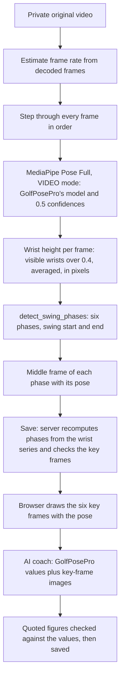

# Swing analysis architecture

The swing report is **GolfPosePro's analysis**: [GolfPosePro](https://github.com/ryanboscobanze/GolfPosePro) (MIT) runs MediaPipe Pose on every frame of the video, takes the wrist height, and splits the swing into six phases from it. The app reproduces that pipeline in the browser and has an AI coach write a comprehensive analysis from exactly those values and the six key frames. A single phone camera still cannot provide foolproof biomechanical measurements; nothing here is validated against a capture system.

## End-to-end data path



The phase detection is a line-for-line port of the notebook's `detect_swing_phases`, including NumPy float32 rounding and SciPy's running-sum filter, which carries a NaN forward once a frame has no visible wrist. Running the notebook's own functions on its four sample videos (MediaPipe 0.10.21) and the port on the same wrist series gives identical frames for every phase (`lib/golfposepro/phases.test.ts`). Running the browser's model (Pose Landmarker Full in VIDEO mode) over the same videos lands within one to four frames of the notebook's phases. In the app, the iron sample read 564 frames and matched the notebook's printed phases within one frame.

## Modules and contracts

| Module | Responsibility | Boundary |
| --- | --- | --- |
| `lib/golfposepro/phases.ts` | GolfPosePro's wrist rule and `detect_swing_phases` | Pure; pinned to the notebook's results by tests. Do not "improve" it |
| `lib/golfposepro/result.ts` | Result shape, key frames at phase middles, a ≤96-frame track for the overlay and comparisons | Pure; phases computed on the stored (0.01 px) wrist values |
| `lib/golfposepro/capture.ts` | Frame-rate probe, every-frame stepping, GPU-to-CPU fallback | Browser only; at most 1,800 frames and six minutes |
| `lib/pose-detector.ts` | Pinned model assets; GolfPosePro's Full VIDEO-mode landmarker | VIDEO mode needs frames in order with rising timestamps |
| `app/actions.ts` (`savePoseModelAction`) | Validates the wrist series and key frames, recomputes the phases, stores the result | Client phases are never trusted |
| `lib/ai/swing-feedback.ts` | Facts from GolfPosePro's values, AI call with key-frame images, rule-based report | Quoted figures must appear in the values; low effort keeps a call near 35 s |
| `app/swing-coach-actions.ts` | Writes feedback once per result, club, handedness and model, and saves it | Saved without changing the swing's revision |
| `components/swing/swing-report.tsx` | Phases, wrist trajectory, key frames, AI analysis | Key frames are drawn from the player's own video |
| `lib/golf/motion-analysis.ts`, `lib/swing/review.ts` | Projected review of the stored track | Used by reference comparison, not by the report |
| `lib/db/repo.ts` | Ownership and atomic revision/source/trim checks | Stale writes fail explicitly, including concurrent tabs |

## Capture and resources

| Resource | Limit |
| --- | --- |
| Frames read | Every frame, up to 1,800 (about a minute at 30 fps); longer clips must be trimmed or re-recorded |
| Reading time | Six-minute deadline; about 45 s for a 564-frame clip in testing |
| Detector | One Full-model landmarker, GPU first, CPU if the GPU fails at start or mid-clip |
| Stored per swing | Wrist height per frame, six key-frame poses, a ≤96-frame overlay track |
| AI call | Low effort, six 360-px key frames, 55-second timeout on a 60-second page function; rule-based report otherwise |

Frame rate is not exposed by browsers, so a short muted playback measures the smallest step between decoded frames. Each frame is then reached by seeking to its centre and waiting for `seeked`. GolfPosePro's frame indices start at the first frame of the analysed clip; times are video seconds, and slow motion stretches every duration while leaving phase ratios unchanged.

## Stored-track review (reference comparison)

The sections below describe the projected 2D review that still runs on the stored overlay track. The swing report does not use it; reference comparisons and the overlay on the video do.

## Evidence rules

Each view has three explicit checks. Face on uses head movement, backswing height and rhythm. Down the line uses projected posture, hip space when ball side is supplied, and rhythm. Every check is supported, uncertain, or unavailable and retains the sample times and reason behind the decision.

1. Validate increasing finite timestamps, frame count, 33 landmarks per frame, coordinate/visibility bounds, aspect ratio and compatible provenance.
2. Reject isolated body/joint jumps without smoothing a missing observation into an invented coordinate.
3. Keep one body identity using proximity and scale consistency. Prefer a central initial golfer; similarly plausible candidates abstain rather than silently selecting a spectator. This remains a heuristic, not biometric re-identification.
4. Require a complete hand arc before automatic phase timing. Hands hidden for up to 0.4 s just after contact (blur or occlusion at 30 fps) do not void it once a rising sample has bracketed the bottom; a follow-through that reappears above the top completes the swing rather than starting a new one. With separate plausible arcs, the last is measured (practice swings usually come first); a wrong pick needs a re-record. Follow-through is not a second backswing merely because it reaches higher.
5. Evaluate each reading independently. Global coverage does not certify a hidden joint at contact. Required joints must support every observed position in an automatic contact or occluded-transition bracket.
6. Require a consistently planted ankle at each displacement position, including bracket endpoints. A global percentile cannot excuse foot/camera movement at the measured moment. This is screening, not optical background stabilization; a camera rotating around an apparently fixed anchor can still evade it.
7. Carry observed contact/transition ranges through head, posture and hip checks. A correction must remain supported throughout the range. Never collapse an uncertain range to the most alarming point.
8. Carry setup/top/contact sampling intervals jointly into rhythm bounds. Withhold rhythm when decoded timestamp provenance is absent. Constant slow-motion scaling preserves a ratio; speed-ramped exports do not. The app cannot currently detect all speed ramps.
9. Timing is automatic only. Phase corrections saved by the former manual tool remain explicit chosen observed frames. Frame resolution still limits rhythm precision, which is why the recording guide asks for slow motion.
10. Coaching is written from calculated facts only: phases, timing, readings with their ranges and notes, check states, tracking warnings and any reference differences. AI never sees raw joint arrays or video. It is told to treat uncertain checks as things to verify and to stay off what the camera cannot measure. Any title, evidence, summary, strength, phase note or caveat quoting a figure that is not in the facts (allowing rounding, a dropped sign and changes between phases of one measurement) is removed; a dropped supported issue falls back to the maintained procedure.

The ranges are sensitivity bounds over observed samples, not statistical confidence intervals. Hand-path bottom is an estimated contact region, not detected club-ball impact. No camera-only result certifies clubface, club path, clubhead speed, pressure transfer, exact pelvic rotation or ball flight.

## Persistence and concurrency

The original private video remains the source. Normalized x/y/visibility and timestamps are stored separately from any legacy 3D research output. New captures discard world output, and compact storage omits inferred depth.

Every model write generates a server revision UUID and copies the detected camera view onto the swing row. The browser submits the revision it reviewed, the stable video reference and the analyzed trim. The server validates ownership and clip consistency, then performs one conditional database update matching owner, recording ID, prior revision, video reference and saved trim. No matching row is a conflict, not a successful save. Demo storage applies the same comparisons. Trims saved before trimming was removed from the UI are still honored.

This provides first-writer-wins conflict detection. It does not promise that the most recently started analysis wins. A conflicting tab must reload explicitly; silently replacing a newer committed result is prohibited. Revision checks use the existing JSONB column, so this change needs no migration.

Local cancellation cannot retract a server action already executing. Revision/source/trim checks prevent that action from overwriting a conflicting committed version. Saving the model and deleting obsolete legacy pose measurements are separate existing repository operations; this is not an atomic transaction across both operations. Manual measurements are never deleted by this cleanup.

## Failure behavior

| Failure | Result |
| --- | --- |
| No readable video metadata, invalid trim, oversized clip | Reject before loading a detector; explain how to retry |
| GPU or worker unavailable | One CPU/foreground fallback with the same model variant and frame bounds |
| Model failure or asynchronous operation hangs | Abort/deadline, cleanup, retry message; no successful completion |
| Repeated decoded source frame | Count duplicate and seek; no duplicate inference or invented timestamp |
| Person identity ambiguous | Drop that observation; unsupported phases/readings remain unavailable |
| Multiple plausible swings | Measure the last one |
| Missing joint near contact | Withhold affected check; preserve independent evidence |
| Stable overall camera, movement at contact | Withhold displacement at contact |
| Coarse/unknown timestamps | Withhold rhythm; retain readable body positions |
| Sampling range crosses a correction threshold | Ask for a clearer slow-motion recording; no definite fault |
| Corrupt/incompatible stored tracks | Fail closed into a review request |
| Competing save, trim change, source change | Reject stale write and request reload |
| AI timeout, invalid output or ungrounded figures | Show the rule-based report; nothing is saved, so the next visit tries again |

## Accuracy evaluation and release eligibility

A spot check ran the Heavy model over every frame of four real clips (two phone recordings with 10–15 s of address and waggles, two speed-ramped pro clips) and replayed the dumps through `runSwingCapture` and the review. Before the zoom pass and the post-contact gap rule no swing was timed; after them all four were timed, the view and playback speed matched what the frames show, and the ramped pro clips showed compressed 1.5–1.8:1 rhythm. Four clips are a smoke test, not a validation corpus.

Run software/failure checks with `npm test`, type checks with `npm run typecheck`, and production compilation with `npm run build`. They establish software behavior only.

Run `npm run evaluate:swing -- path/to/annotated-corpus.json` to evaluate automatic timing and chosen corrections. Add `--release` to return a nonzero exit code unless the corpus meets the configured criteria. This command is available for CI but is not wired to the repository's external Vercel deployment configuration. Without a file it runs a synthetic smoke fixture and explicitly reports **blocked**.

The corpus is an array. Each record contains:

```json
{
  "id": "swing-unique-id",
  "origin": "recorded",
  "split": "holdout",
  "recordingId": "pseudonymous-original-video-id",
  "golferId": "pseudonymous-golfer-id",
  "annotatorId": "independent-coach-id",
  "consented": true,
  "view": "face_on",
  "handedness": "right",
  "sourceFps": 60,
  "occluded": false,
  "shouldAbstain": false,
  "acceptableIssues": ["head"],
  "phases": { "address": 0.24, "top": 1.44, "impact": 1.76 },
  "tracks": {
    "swing_session_id": "evaluation",
    "aspect": 0.5625,
    "t": [0.1, 0.12, 0.14],
    "frames": [],
    "imageFrames": []
  }
}
```

The example shows fields, not a valid populated capture: `tracks` must contain 8–128 strictly ordered samples with 33 packed landmarks per frame and matching `frames`/`imageFrames` arrays accepted by the upload schema. Use image tuples `[x, y, 0, visibility]` in both arrays when exporting new 2D evidence. Preserve the actual capture manifest to evaluate rhythm; absent provenance intentionally withholds it. Labels must be created independently from the model's prediction. `acceptableIssues: []` means no labelled correction; `shouldAbstain` marks evidence that cannot support coaching.

The evaluator rejects duplicate capture IDs, missing recorded annotation/consent provenance, and golfer/original-recording overlap between development and holdout. It excludes synthetic and development records from real-world metrics, and removes manual phase overrides from predictions. It counts missed issues, false corrections, unexpected abstentions and missing automatic timing instead of discarding failures. False-correction rate uses emitted corrections as its denominator so numerous easy clear swings cannot dilute wrong advice.

Initial engineering targets are centralized in `RELEASE_TARGETS`: at least 200 recorded holdout swings across 20 golfers; at least 50 per view; at least 30 left-handed, occluded and low-frame-rate examples; at least 100 labelled phase sequences; at least 90% phase resolution; phase p95 absolute error no greater than 80 ms; false corrections at most 5%; missed labelled issues at most 20%; and unexpected abstention at most 35%. Error/coverage checks run overall and within the listed strata where applicable. These are proposed acceptance targets, not measured performance or certified golf standards. An eligible report still requires human review and capture-device evaluation.

Before accuracy claims, collect consented real recordings spanning phones, browser/worker fallbacks, body types, clothing, skin tones, lighting, motion blur, occlusion, camera roll/pan/zoom, 24–240 fps, mirrored/left-handed footage, constant slow motion and speed ramps. Measure detector coordinate error against independent image labels as well as coach agreement. The current evaluator measures downstream phase/coaching error from supplied tracks; it does **not** run video decoding or MediaPipe on the corpus, measure pose coordinate error, certify 3D biomechanics, measure battery use, or measure p50/p95 device latency. Those experiments remain required.

## Primary implementation references

- [MediaPipe Pose Landmarker](https://developers.google.com/edge/mediapipe/solutions/vision/pose_landmarker): model variants and landmark semantics.
- [MediaPipe Web guide](https://ai.google.dev/edge/mediapipe/solutions/vision/pose_landmarker/web_js): synchronous inference and worker guidance.
- [Decoded video frame callbacks](https://developer.mozilla.org/en-US/docs/Web/API/HTMLVideoElement/requestVideoFrameCallback): media presentation timestamps.
- [Bitmap resizing](https://developer.mozilla.org/en-US/docs/Web/API/Window/createImageBitmap): bounded frame preprocessing.
